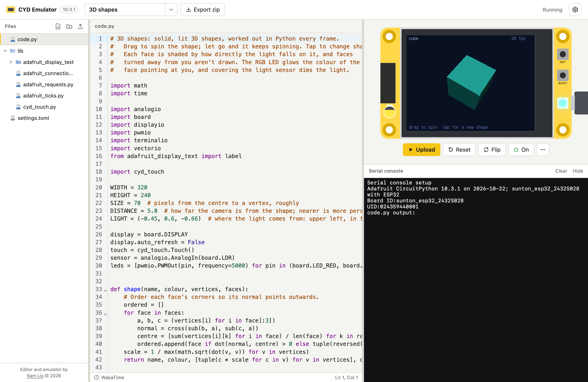

# Cheap Yellow Display Emulator

Emulate and write firmware (CircuitPython) for the Cheap Yellow Display (ESP32-2432S028R) in the browser.

Try it here: https://cyd.samliu.dev

## Features

- Real CircuitPython 10.3.1, with Python running at an ESP32's speed
- Screen, touch, RGB LED, light sensor, and the BOOT and RST buttons
- microSD card, formatted or blank, in sizes up to 32 GB
- Wi-Fi: `wifi`, `socketpool`, `ssl` and `adafruit_requests`, with DNS and NTP
- `microcontroller.nvm`, `watchdog`, and `alarm` with light and deep sleep
- Projects saved in the browser, and exported as a zip to copy to a real board
- Examples: touch paint, 3D shapes, bouncy balls, weather and more
- Coding time tracking with WakaTime or Hackatime

## Limitations

- Network: HTTP and HTTPS only, through a proxy. No raw TCP or UDP, except DNS and NTP.
- No `touchio`, audio, Bluetooth or USB devices, and nothing wired to the GPIO pins.
- Only Python runs at the ESP32's speed. Work done in C, like drawing, runs at your computer's speed.
- Needs a browser that allows `SharedArrayBuffer`, which most current browsers do.

## How it works, in a nutshell

CircuitPython is compiled to WebAssembly with a custom port (`firmware/`). The port sends the
board's hardware calls to JavaScript models of its chips: the ILI9341 display, the XPT2046
touch controller, the SD card, the LED and the light sensor (`web/src/emulator/`).
CircuitPython runs in a Web Worker and shares memory with the page. Network requests go
through a small proxy (`web/server/`).

## License

[GNU AGPL v3](LICENSE). The bundled Adafruit libraries and the files from CircuitPython are MIT licensed.
